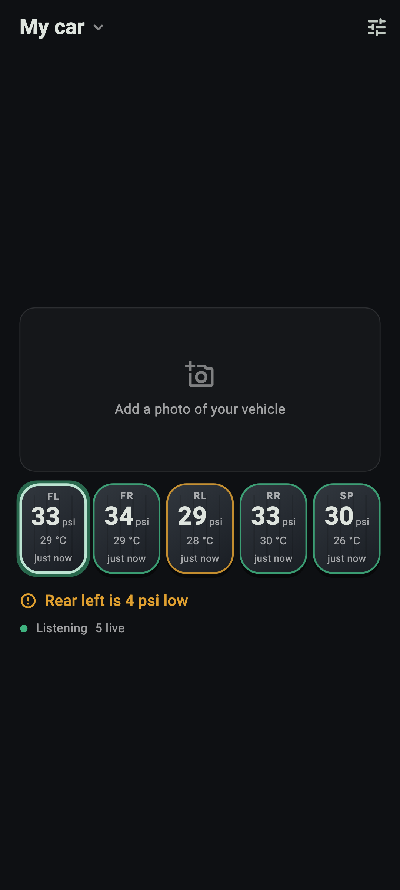
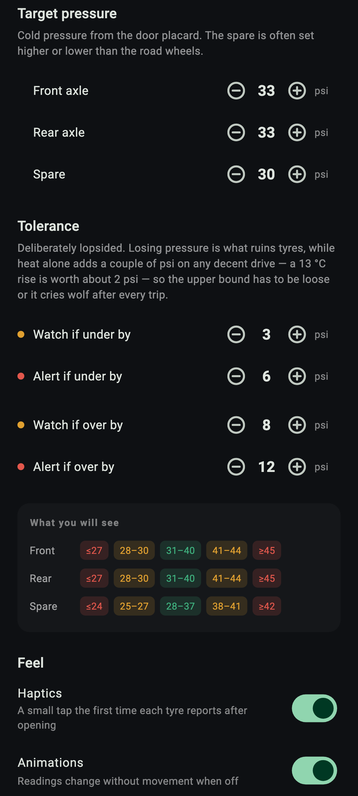
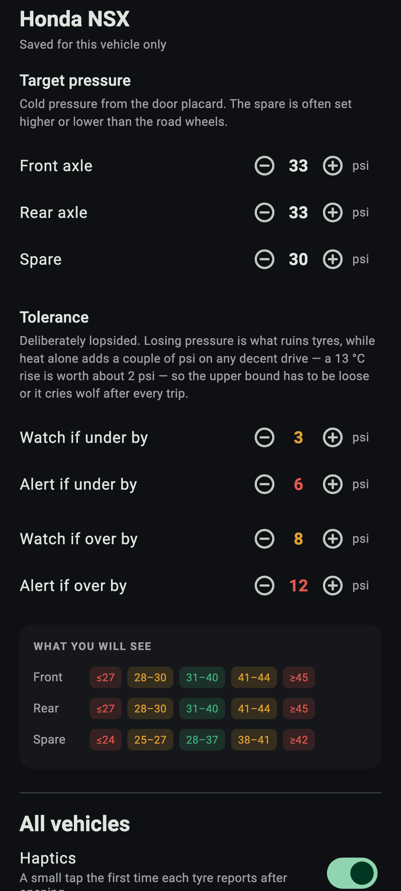

# TPMS Libre

Tyre pressure and temperature from **JK Tyre Treel** Bluetooth TPMS sensors,
offline. No account, no network access.

The sensors broadcast their readings in the clear, yet the manufacturer's app
wants a login, your photos and your crash logs.

<p>
  
  
  
</p>

[More screenshots](fastlane/metadata/android/en-US/images/phoneScreenshots/),
including landscape for a car mount.

## Install

<a href="https://f-droid.org/packages/com.asahiconsultants.tpmslibre/"></a>

Android 7 or later, on a phone with Bluetooth LE.

## Supported sensors

- **JK Tyre Treel**: the car and two-wheeler sensors sold with the *SMART TYRE
  CAR & BIKE* / *Treel Care* apps.

Decoders for other BLE sensors are welcome; see [How it works](#how-it-works).

## Features

- Live pressure (psi) and temperature (°C) for every wheel
- Cars with or without a spare, motorcycles, and several vehicles at once
- Front and rear targets, with a tight lower and a loose upper tolerance:
  heat alone adds a few psi on a drive
- Assign sensors to wheels, and swap them after a tyre rotation
- Your own photo of the vehicle
- Portrait or landscape, for a car mount

## Permissions

| | Permission | Why |
|---|---|---|
| ✅ | Bluetooth (*Nearby devices*) | To hear the sensors. Nothing is paired. |
| ⚠️ | Location | Never read, but Android hides these sensors' readings without it. |
| ❌ | Internet | Not requested: nothing can leave the phone. |
| ❌ | Photos | Not requested: you pick one picture with Android's photo picker. |

Bluetooth and Location must both be switched on while the app is listening.

<details>
<summary>Checking an APK yourself</summary>

`aapt2 dump permissions app-release.apk` lists:

- `BLUETOOTH_SCAN`, `BLUETOOTH_CONNECT`: Bluetooth (`BLUETOOTH` and
  `BLUETOOTH_ADMIN` up to Android 11)
- `ACCESS_FINE_LOCATION`, `ACCESS_COARSE_LOCATION`: location
- `DYNAMIC_RECEIVER_NOT_EXPORTED_PERMISSION`: private to the app, added by
  AndroidX

Debug builds also have `INTERNET`, for Flutter's hot reload.

</details>

## How it works

Each sensor broadcasts a standard iBeacon frame under Apple's manufacturer id
`0x004C`, with the readings in the fields a real iBeacon uses for identity:

```
02 15 | ff ff ff ff ff ff ff ff ff ff ff ff ff ff ff e0 | MM MM | mm PP | TT
```

| field | bytes | meaning |
|---|---|---|
| UUID | 16 | `ff…ffe0` on every sensor; identifies a Treel |
| major | 2 | the 4th and 5th octets of the sensor's MAC |
| minor | 2 | the 6th octet of its MAC, then **pressure in psi** |
| tx power | 1 | **temperature: °C = byte − 110** |

The MAC octets are the sensor's id, since phones hide Bluetooth addresses.
Resolution is 1 psi and 1 °C. Both scales were checked against the vendor app
on five sensors, and again after a drive: pressure rose with temperature as
physics predicts, to within 0.2 psi across 27–41 °C.

Sensors report often while the wheel turns and every few minutes when parked.
The battery level is not in this frame, presumably in a second, encrypted
advertisement, so the app does not show one.

The decoder is [`lib/treel/reading.dart`](lib/treel/reading.dart). Another
sensor needs a decoder that turns one advertisement into an id, a pressure and
a temperature.

## Building

Android only, with Flutter 3.47.5 (pinned in `pubspec.yaml`):

```
flutter build apk --release
flutter test
```

Golden-image tests are skipped by default; see `dart_test.yaml`.

## Credits

The screenshots are rendered from the app's own widgets by
`test/store_screenshots_test.dart`. Their vehicle photos are from
[Pexels](https://www.pexels.com/), under the
[Pexels License](https://www.pexels.com/license/) rather than MIT, and are not
shipped in the app:
[*A Red Sports Car*](https://www.pexels.com/photo/a-red-sports-car-17638358/)
by WAVYVISUALS and
[*Photo of a Red and Black Big Bike*](https://www.pexels.com/photo/photo-of-a-red-and-black-big-bike-12801272/)
by Akash A G.

## Not affiliated

JK Tyre, Treel, Honda, TVS and their models are trademarks of their owners.
TPMS Libre is independent, and not affiliated with or endorsed by JK Tyre &
Industries or TREEL Mobility Solutions. It reads the broadcasts of sensors you
own.

## Support

TPMS Libre is a non-commercial project: free, with no ads and nothing to
unlock. If it is useful to you, a donation helps keep it going.

[](https://ko-fi.com/asahiconsultants)

## License

[MIT](LICENSE).
